# Lab 02: Control de Aplicaciones con Firmas Base (Application Control L7)

## Ficha Técnica y Cumplimiento

| Campo | Detalle |
| :--- | :--- |
| **ID del Documento** | SOP-SEC-002 |
| **Versión / Fecha** | v1.0 — Noviembre 2026 |
| **Plataforma** | VMware Workstation Pro, FortiGate-VM64 (FortiOS 7.6.8 Trial), Kali Linux 2026.3 |
| **Paquete de Firmas** | `Application Definitions` y `Proxy Application Definitions` `v6.00741 signed` (Embebido de fábrica, sin FortiGuard Cloud) |
| **Controles ISO/IEC 27002:2022** | **A.8.20** (Seguridad de redes), **A.8.22** (Segregación de redes), **A.8.23** (Filtrado web y control de aplicaciones), **A.8.15** (Registro de eventos), **A.8.24** (Inspección TLS) |
| **Marco NIST** | NIST SP 800-41 Rev. 1 / NIST CSF 2.0 (*Protect* y *Detect*) |

---

## 1. Escenario y Objetivo de Negocio

Los firewalls tradicionales de Capa 3/4 filtran tráfico únicamente por dirección IP y número de puerto (por ejemplo, bloqueando TCP 22 para impedir SSH), pero quedan ciegos cuando las aplicaciones modernas encapsulan sus protocolos sobre puertos permitidos como TCP 443 (`HTTPS`) o negocian conexiones P2P sobre puertos efímeros dinámicos.

El objetivo de este laboratorio es desplegar y auditar el motor de **Application Control** en FortiOS utilizando el paquete de firmas estáticas embebido de fábrica (`v6.00741`), con el fin de detectar y bloquear aplicaciones de riesgo —como **evasión SSH en puerto 443**, servicios de mensajería (**WhatsApp / WhatsApp Web**), herramientas de escritorio remoto (**AnyDesk / TeamViewer**) y clientes P2P (**BitTorrent**)— demostrando la identificación en Capa 7 independiente del puerto y documentando el alcance real de las firmas offline frente a protocolos modernos sobre TLS 1.3.

---

## 2. Topología y Direccionamiento

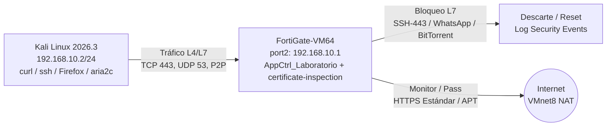

| Dispositivo | Interfaz | Red Virtual | Dirección IP | Rol |
| :--- | :--- | :--- | :--- | :--- |
| **FortiGate-VM64** | `port1` | VMnet8 (NAT) | DHCP (`192.168.167.x`) | WAN / Salida a Internet |
| **FortiGate-VM64** | `port2` | VMnet2 (Host-only) | `192.168.10.1/24` | LAN / Gateway + Motor IPS/AppCtrl |
| **Kali Linux 2026.3** | `eth0` | VMnet2 (Host-only) | `192.168.10.2/24` | Cliente de pruebas (evasión L7, web y P2P) |

---

## 3. Implementación Técnica

### 3.1 Verificación de Firmas Embebidas de Fábrica en FortiOS
Antes de crear los perfiles de seguridad se confirmó en la consola CLI que la base de datos local de firmas estaba cargada y firmada sin requerir licencia FortiGuard activa:

```text
diagnose autoupdate versions | grep -A 5 "Application Definitions"
```

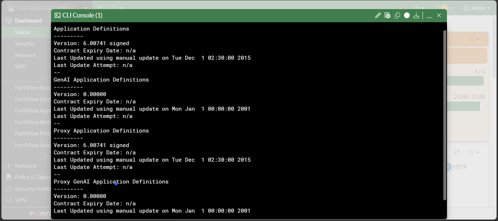

### 3.2 Creación del Perfil `AppCtrl_Laboratorio`
En **Security Profiles > Application Control** se creó el perfil `AppCtrl_Laboratorio` combinando bloqueo por categorías y reglas específicas (*Application and Filter Overrides*, evaluadas con mayor prioridad de arriba hacia abajo):

* **Categorías en `Block`:** `P2P`, `Proxy` y `Remote Access`.
* **Resto de categorías en `Monitor`:** `Business`, `Cloud/IT`, `Collaboration`, `Email`, `Game`, `General Interest`, `Mobile`, `Network Service`, `Social Media`, `Storage/Backup`, `Update`, `Video/Audio`, `VoIP` y `Web Client` (para registrar telemetría completa de sesiones permitidas).
* **Application and Filter Overrides (`Block`):**
  1. **Prioridad 1 (Mensajería):** `Telegram`, `Whatsapp`, `WhatsApp_VoIP.Call`, `Whatsapp_Web`, `WhatsApp.File_Transfer`.
  2. **Prioridad 2 (Evasión y Acceso Remoto):** `SSH`, `AnyDesk`, `Teamviewer`, `Teamviewer_CallReceive`, `Teamviewer_CallRequest`.
  3. **Prioridad 3 (P2P):** `BitTorrent`, `BitTorrent.Bleep`, `BitTorrent.Sync`.

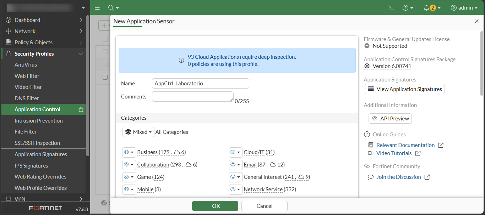
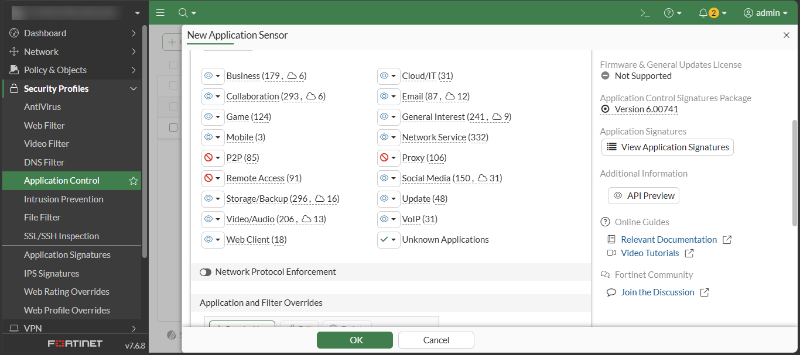
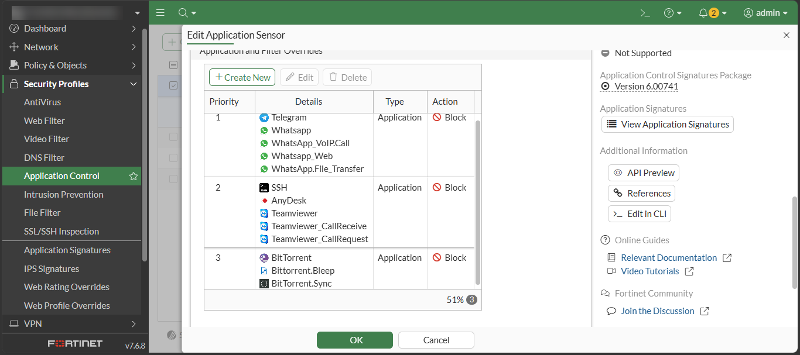

### 3.3 Vinculación a la Política de Firewall (`Laboratorio`)
El perfil `AppCtrl_Laboratorio` se vinculó a la política `ID 1` (`Laboratorio`, `port2 -> port1`) con registro en `All Sessions`. Tras diagnosticar un conflicto TLS `bad record mac` en VMware al combinar `ipsengine` con `custom-deep-inspection`, el perfil de inspección SSL se ajustó a **`certificate-inspection`**, suficiente para inspeccionar SNI, certificados y firmas binarias de protocolos en Capa 7.

```text
config firewall policy
    edit 1
        set ssl-ssh-profile "certificate-inspection"
        set application-list "AppCtrl_Laboratorio"
        set logtraffic all
    next
end
```

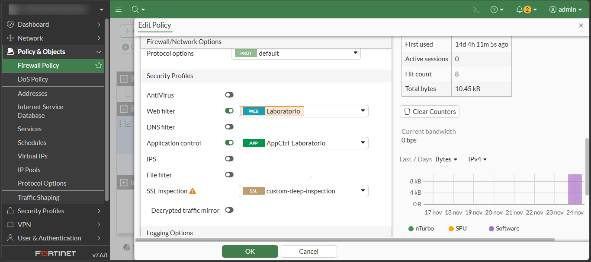

> El bloque CLI completo y sanitizado se encuentra en [`configs/fortigate-appctrl-sanitized.conf`](configs/fortigate-appctrl-sanitized.conf).

---

## 4. Validación y Evidencias (Pruebas Positivas y Negativas)

### 4.1 Línea Base Permitida en Puerto 443 (Control)
Se validó que la navegación HTTPS estándar continúa operando sin interrupciones (`HTTP/2 200`) y queda auditada en modo `Monitor`:

```bash
curl -I https://www.debian.org
```

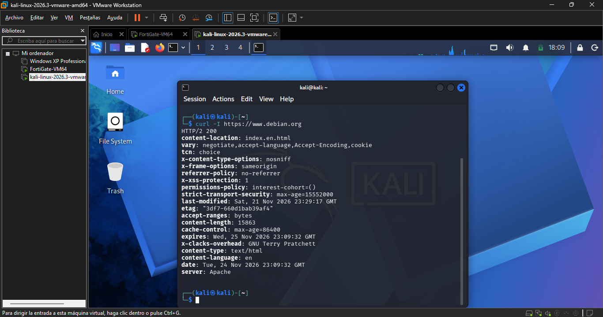

### 4.2 Evasión de Puerto — SSH Disfrazado en Puerto TCP 443
GitHub dispone de un endpoint SSH real en TCP 443 (`ssh.github.com:443`) diseñado para evadir firewalls tradicionales L3/L4. Aunque la política `Laboratorio` permite el puerto 443 (`HTTPS`), el motor de Application Control detectó la cadena `SSH-2.0` tras establecerse el túnel TCP y descartó la sesión (`Connection timed out during banner exchange`):

```bash
ssh -v -o ConnectTimeout=5 -p 443 git@ssh.github.com
```

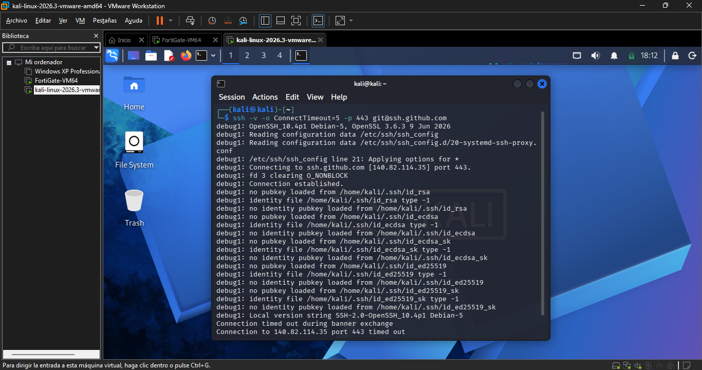

### 4.3 Mensajería sobre HTTPS (`web.whatsapp.com` en Puerto 443 y DNS 53)
Tras incorporar las subfirmas completas de WhatsApp (`Whatsapp` AppID `28057` y `Whatsapp_Web` AppID `39999`), FortiGate interceptó tanto las consultas DNS (UDP 53) como el establecimiento de sesión TLS en TCP 443 hacia `web.whatsapp.com`:

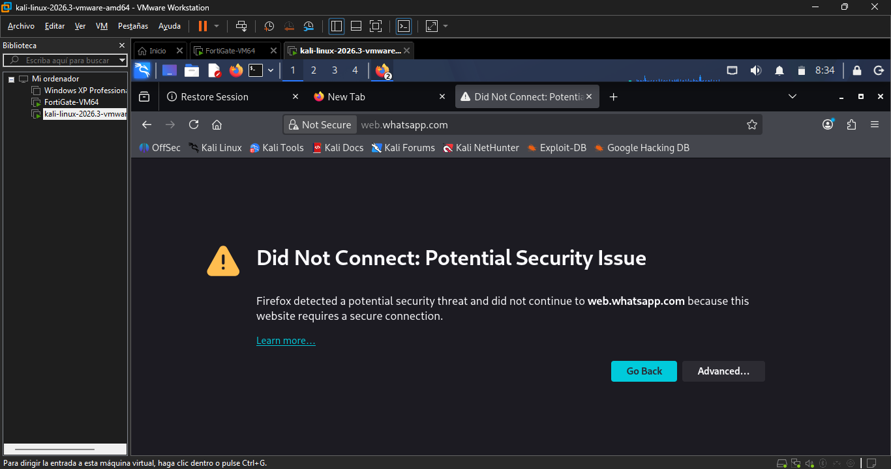

### 4.4 Clientes P2P (`BitTorrent`) en Puertos Dinámicos
Para comprobar que el bloqueo P2P ocurre en Capa 7 (Application Control) y no por el filtro de puertos L4, se habilitó temporalmente `service "ALL"` y se desvinculó el filtro web `*kali*` en FortiGate para instalar `aria2` y lanzar un archivo `.torrent` oficial de Debian:

```bash
sudo apt update && sudo apt install -y aria2
TORRENT_URL="https://cdimage.debian.org/debian-cd/current/amd64/bt-cd/$(curl -sL https://cdimage.debian.org/debian-cd/current/amd64/bt-cd/ | grep -oE 'debian-[0-9.]+-amd64-netinst\.iso\.torrent' | head -n 1)"
aria2c --seed-time=0 --bt-stop-timeout=20 "$TORRENT_URL"
```

* **Resultado:** `aria2c` descargó el archivo `.torrent` por HTTPS a `160 KiB/s` (`OK`), pero la transferencia del enjambre P2P permaneció bloqueada en **`0B/s`** (`CN:0 SD:0 DL:0B`) hasta agotar el timeout de 20 segundos (`ERR`). Al finalizar se restauró `service "DNS" "HTTP" "HTTPS"` y `webfilter-profile "Laboratorio"`.

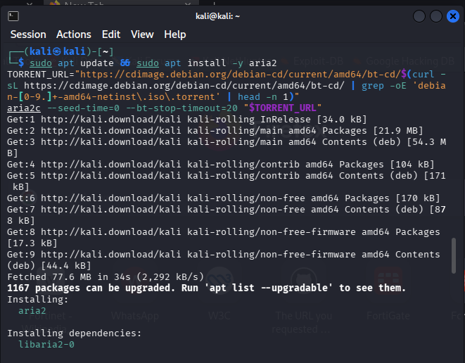
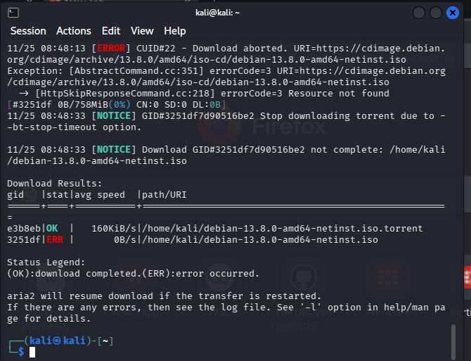

---

## 5. Auditoría Cuantitativa de Logs (164 Eventos)

Se exportaron los eventos de **Log & Report > Security Events > Application Control** (`disk-app-ctrl-2026-11-25_05-54-sanitized.log`) y se consolidó un tablero ejecutivo en Excel con fórmulas dinámicas, gráficos y conversión horaria (`UTC-8` a `UTC-5`):

* **Reporte Excel:** [`reports/FortiGate_AppControl_Analisis_Logs_Lab02.xlsx`](reports/FortiGate_AppControl_Analisis_Logs_Lab02.xlsx)
* **Log crudo sanitizado:** [`reports/disk-app-ctrl-2026-11-25_05-54-sanitized.log`](reports/disk-app-ctrl-2026-11-25_05-54-sanitized.log)

| Hallazgo / Aplicación | AppID | Puerto / Servicio | Bloqueados | Permitidos | Interpretación Técnica |
| :--- | :---: | :---: | :---: | :---: | :--- |
| **`SSH` (Evasión puerto 443)** | `16060` | `443 / TCP` | **1** | 1 | Evidencia clave de bloqueo independiente del puerto (24-Nov `15:12` UTC-8) y contraste posterior (25-Nov `05:53` UTC-8). |
| **`Whatsapp` (Capa 7 en DNS)** | `28057` | `53 / UDP` | **10** | 0 | Detección L7 de firma de mensajería directamente dentro de consultas DNS. |
| **`Whatsapp_Web` (HTTPS 443)** | `39999` | `443 / TCP` | **6** | 4 | Evidencia **Antes vs. Después**: 4 `pass` antes de añadir la subfirma `39999` y 6 `block` tras incorporarla al Override. |
| **Telegram Web / AnyDesk HTTP** | `40568` / `15895` | `443 / TCP` | 0 | 56 | Clasificados como `HTTPS.BROWSER` / `SSL`: evidencia del límite de firmas estáticas de 2015 frente a TLS 1.3 y peticiones HTTP no binarias. |
| **Control (`debian.org`, `Apt-Get`)** | `40568` / `27508` / `40565` | `443` / `80` | 0 | 18 | Línea base HTTPS operativa, detección granular de `Apt-Get` / `Ubuntu.Update` y descarga HTTPS del `.torrent`. |
| **Telemetría de fondo (Firefox)** | `40568` / `15895` / `34050` | `443` / `80` | 0 | 58 | Tráfico automático en segundo plano del navegador registrado en modo `Monitor`. |

---

## 6. Matriz de Troubleshooting (Incidencias Resueltas)

| Síntoma / Error | Causa Raíz | Solución Aplicada |
| :--- | :--- | :--- |
| `curl: (35) TLS connect error: decryption failed or bad record mac` al activar Application Control | Al activar `AppCtrl_Laboratorio`, FortiOS 7.6.8 inicia `ipsengine` en paralelo con el proxy de re-cifrado completo (`custom-deep-inspection`), corrompiendo el MAC de registros TLS 1.3 / HTTP/2 en entorno VMware. | Se cambió el perfil SSL de la política a `certificate-inspection`, que permite inspección L7 de SNI, certificados y firmas de protocolos sin corromper registros TLS 1.3. |
| `web.whatsapp.com` cargaba parcialmente por TCP 443 aunque `Whatsapp` se bloqueaba en DNS | FortiOS separa la firma base `Whatsapp` (`AppID 28057`) de su subfirma web `Whatsapp_Web` (`AppID 39999`). Al estar la categoría `Collaboration` en `Monitor`, el túnel HTTPS no coincidía con el Override inicial. | Se amplió el Override de Prioridad 1 incorporando `Whatsapp_Web`, `WhatsApp_VoIP.Call` y `WhatsApp.File_Transfer` con acción `Block`. |
| `web.telegram.org` y `curl https://boot.net.anydesk.com` no fueron bloqueados | La base estática de fábrica (`v6.00741`, diciembre 2015) no posee firmas SNI actualizadas para Telegram Web sobre TLS 1.3, y la firma de AnyDesk espera el *handshake* binario del cliente remoto, no una petición web `HTTP GET` (`303`). | Se documentó el comportamiento con evidencia de logs (`HTTPS.BROWSER` / `SSL`) como hallazgo técnico real del alcance de firmas offline sin suscripción FortiGuard. |
| `Err:1 http://http.kali.org/kali ... 403 Forbidden` al instalar `aria2` | El perfil `Web Filter` (`Laboratorio`) del Lab 01 seguía activo con la regla comodín `*kali*`, bloqueando los propios repositorios oficiales de Kali Linux. | Se ejecutó temporalmente `unset webfilter-profile` y `set service "ALL"` durante la instalación de `aria2` y la prueba BitTorrent, restaurando el endurecimiento al concluir. |
| Diferencia de 3 horas entre los logs exportados y las capturas en Kali Linux | El reloj del sistema en FortiGate registraba eventos en `tz="-0800"` frente a la hora local de Colombia (`UTC-5`). | Se incorporó una columna calculada de hora local (`UTC-5`) en el reporte Excel para correlacionar exactamente cada captura con su `sessionid`. |
