# Lab 03: Autenticación, Usuarios Locales, Portal Cautivo y Políticas por Identidad

## Ficha Técnica y Cumplimiento

| Campo | Detalle |
| :--- | :--- |
| **ID del Documento** | SOP-SEC-003 |
| **Versión / Fecha** | v1.0 — Noviembre 2026 |
| **Plataforma** | VMware Workstation Pro, FortiGate-VM64 (FortiOS 7.6.8 Trial), Kali Linux 2026.3 |
| **Controles ISO/IEC 27002:2022** | **A.5.15** (Control de acceso), **A.5.17** (Información de autenticación), **A.8.5** (Autenticación segura), **A.8.20** (Seguridad de redes), **A.8.23** (Filtrado web), **A.8.15** (Registro de eventos) |
| **Marco NIST** | NIST SP 800-41 Rev. 1 / NIST CSF 2.0 (*Protect* y *Detect*) |

---

## 1. Escenario y Objetivo de Negocio

En redes corporativas o de invitados, aplicar reglas únicamente por dirección IP resulta insuficiente cuando múltiples usuarios comparten un mismo segmento o estación de trabajo. Sin autenticación activa en el perímetro, cualquier equipo conectado a la LAN puede heredar permisos genéricos y dificultar la trazabilidad individual en incidentes de seguridad.

El objetivo de este laboratorio es implementar **control de acceso basado en identidad** sobre FortiGate mediante un **Portal Cautivo local** en la interfaz LAN (`port2`), exigiendo autenticación web previa a cualquier salida hacia Internet y aplicando políticas diferenciadas según el grupo del usuario autenticado (`Grupo_TI` con acceso completo frente a `Grupo_Invitados` con puertos acotados y filtrado L7 de Web Filter y Application Control).

---

## 2. Topología y Flujo de Autenticación

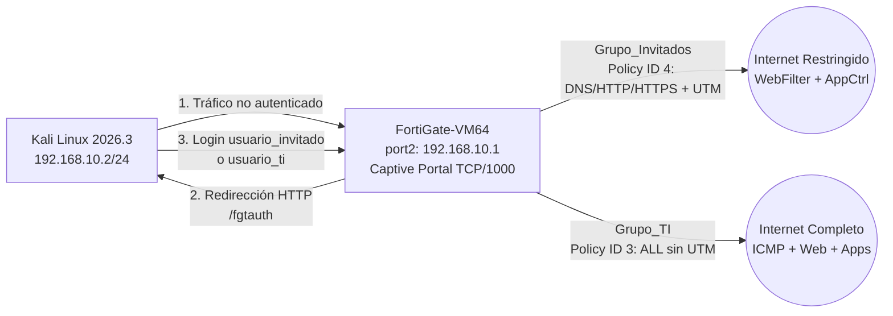

| Dispositivo | Interfaz | Red Virtual | Dirección IP | Rol |
| :--- | :--- | :--- | :--- | :--- |
| **FortiGate-VM64** | `port1` | VMnet8 (NAT) | DHCP (`192.168.167.x`) | WAN / Salida a Internet |
| **FortiGate-VM64** | `port2` | VMnet2 (Host-only) | `192.168.10.1/24` | LAN / Gateway + Portal Cautivo (`TCP/1000`) |
| **Kali Linux 2026.3** | `eth0` | VMnet2 (Host-only) | `192.168.10.2/24` | Cliente LAN evaluado bajo ambas identidades |

---

## 3. Implementación Técnica

### 3.1 Definición de Usuarios Locales y Grupos
En **User & Authentication > User Definition** y **User Groups** se crearon dos cuentas locales con distintos privilegios asociadas a sus respectivos grupos de firewall:

| Usuario Local | Tipo | Grupo de Firewall | Perfil de Acceso Esperado |
| :--- | :--- | :--- | :--- |
| `usuario_ti` | Local User | `Grupo_TI` | Acceso total (`ALL`), incluyendo ICMP, Wikipedia `/wiki/Linux` y WhatsApp Web. |
| `usuario_invitado` | Local User | `Grupo_Invitados` | Solo `DNS`, `HTTP`, `HTTPS` (sin ICMP) con `Web Filter` (`Laboratorio`) y `Application Control` (`AppCtrl_Laboratorio`). |

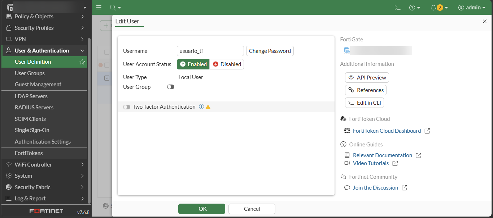
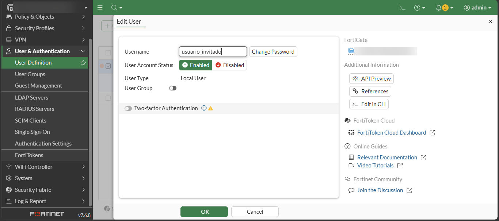
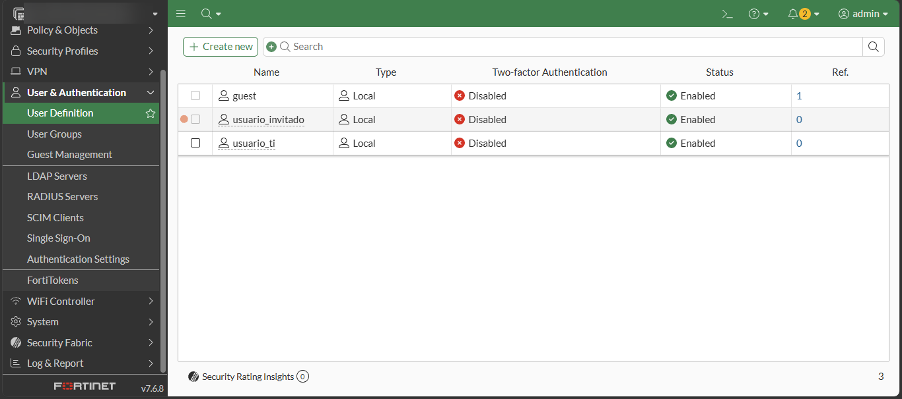
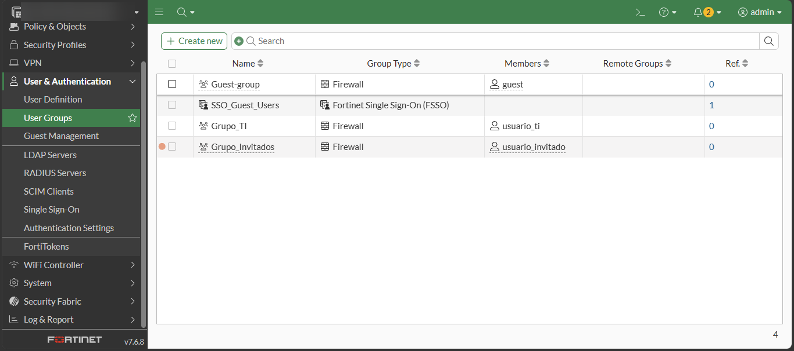

### 3.2 Activación del Portal Cautivo en `port2`
En **Network > Interfaces > `port2`** se activó **Security Mode: Captive Portal** en modo **Local**, restringido explícitamente a `Grupo_TI` y `Grupo_Invitados` (*Restricted to Groups*) con redirección al destino original tras el inicio de sesión:

```text
config system interface
    edit "port2"
        set security-mode captive-portal
        set security-groups "Grupo_TI" "Grupo_Invitados"
    next
end
```

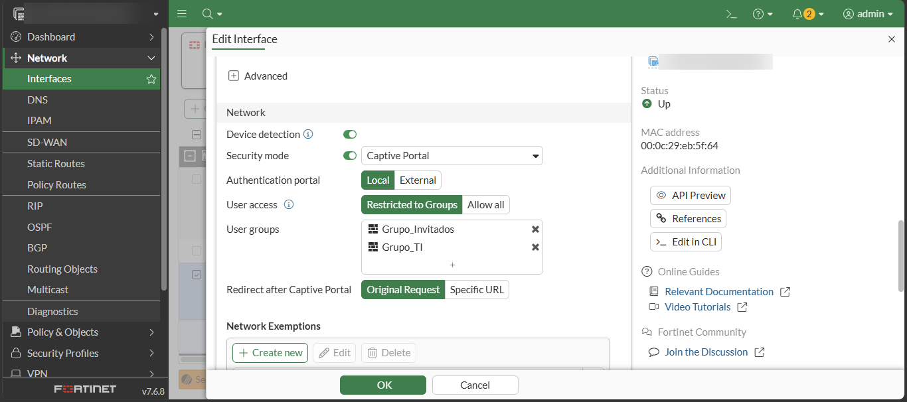

### 3.3 Políticas de Firewall por Identidad (Grupo)
Para evitar que la política genérica previa (`Laboratorio`, ID 1) omitiera la evaluación por grupo, se deshabilitó temporalmente y se crearon dos políticas diferenciadas por identidad:

* **`Politica_Grupo_TI` (ID 3):** `port2` → `port1`, `Source: all` + `Grupo_TI`, `Service: ALL`, sin perfiles UTM restrictivos y con registro `All sessions`.
* **`Politica_Grupo_Invitados` (ID 4):** `port2` → `port1`, `Source: all` + `Grupo_Invitados`, `Service: DNS, HTTP, HTTPS`, con perfiles `Web Filter` (`Laboratorio`), `Application Control` (`AppCtrl_Laboratorio` incluyendo bloqueo de **QUIC**) e inspección SSL ajustada para validar bloqueos granulares en HTTPS.

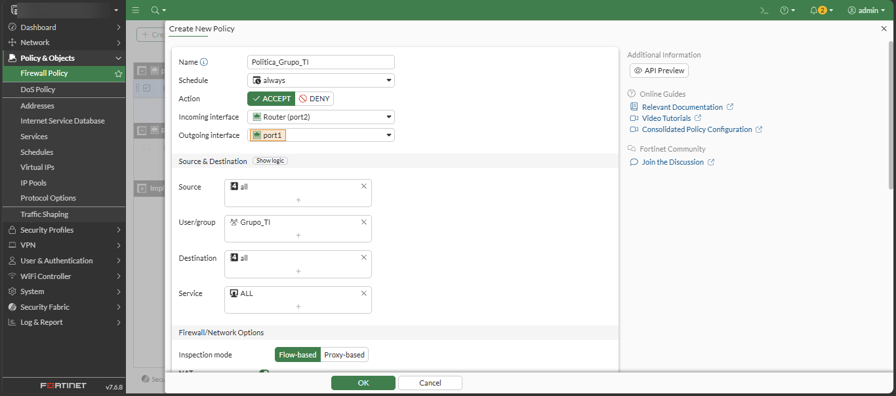
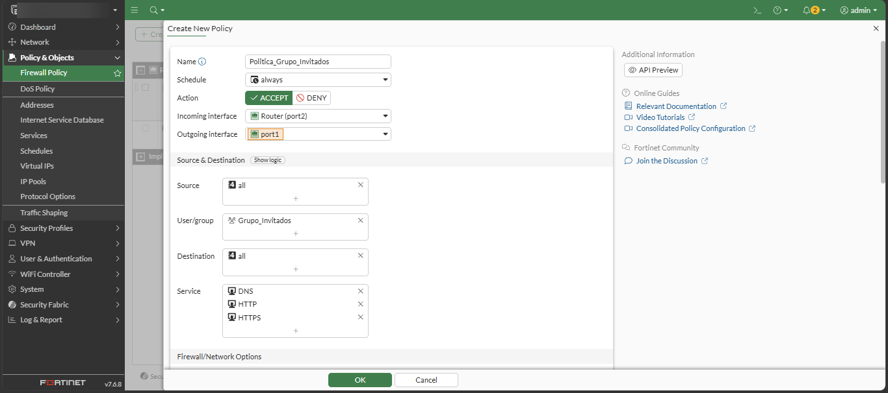
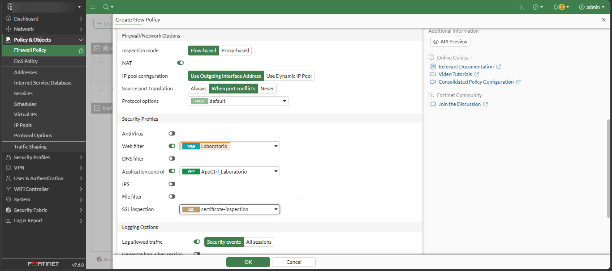

El bloque CLI completo y sanitizado se encuentra en [`configs/fortigate-captive-portal-sanitized.conf`](configs/fortigate-captive-portal-sanitized.conf).

---

## 4. Validación y Evidencias (Pruebas Positivas y Negativas)

### Matriz de Contraste por Identidad (`192.168.10.2`)

| Prueba Ejecutada desde Kali Linux | Sin Autenticar | `usuario_invitado` (`Grupo_Invitados`) | `usuario_ti` (`Grupo_TI`) |
| :--- | :---: | :---: | :---: |
| `ping -c 3 8.8.8.8` (ICMP) | Bloqueado (`100% loss`) | Bloqueado (`100% loss`) | Permitido (`0% loss`) |
| `http://neverssl.com` (HTTP/80) | Redirige a `192.168.10.1:1000/fgtauth` | Permitido tras login | Permitido tras login |
| `https://es.wikipedia.org/wiki/Linux` | Bloqueado | Bloqueado (`Local URLfilter Block`) | Permitido |
| `https://web.whatsapp.com` | Bloqueado | Bloqueado (`Application Blocked: Whatsapp_Web`) | Permitido |

### 4.1 Bloqueo Previo a la Autenticación
Antes de iniciar sesión en el Portal Cautivo, FortiGate descarta cualquier intento de salida a Internet desde `192.168.10.2` (`100% packet loss`):

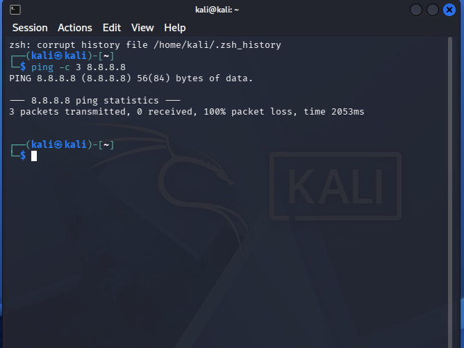

### 4.2 Redirección al Portal Cautivo e Inicio de Sesión como `usuario_invitado`
Al solicitar `http://neverssl.com`, FortiGate intercepta la petición HTTP y redirige automáticamente a `http://192.168.10.1:1000/fgtauth...` mostrando la pantalla **Authentication Required**. Tras ingresar las credenciales de `usuario_invitado`, se libera la navegación hacia `neverssl.com`:

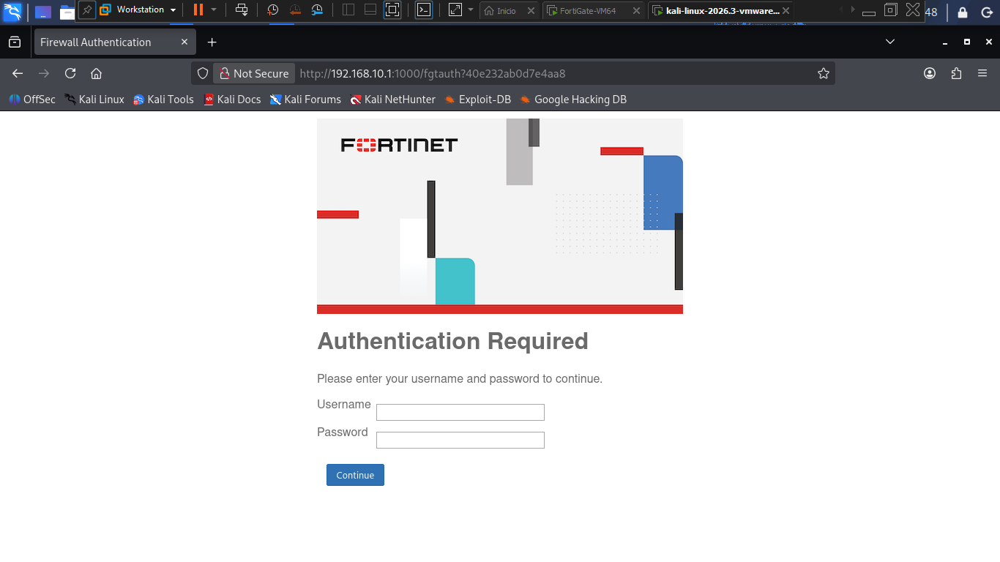
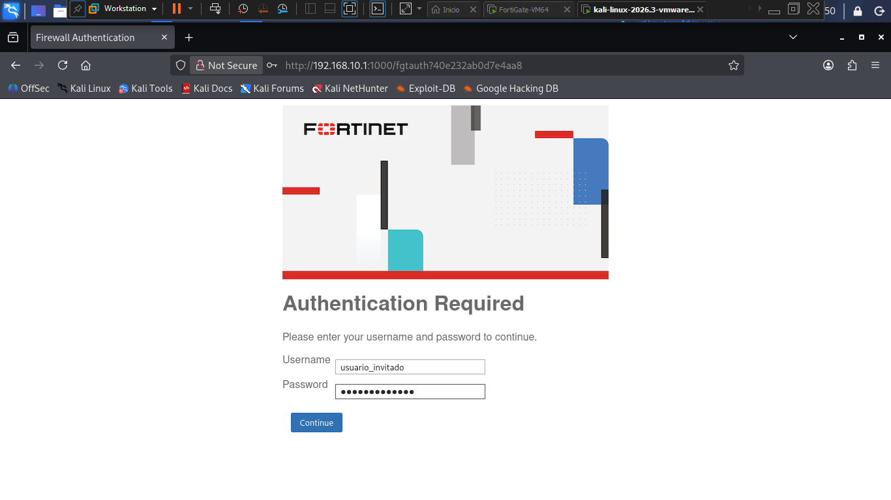
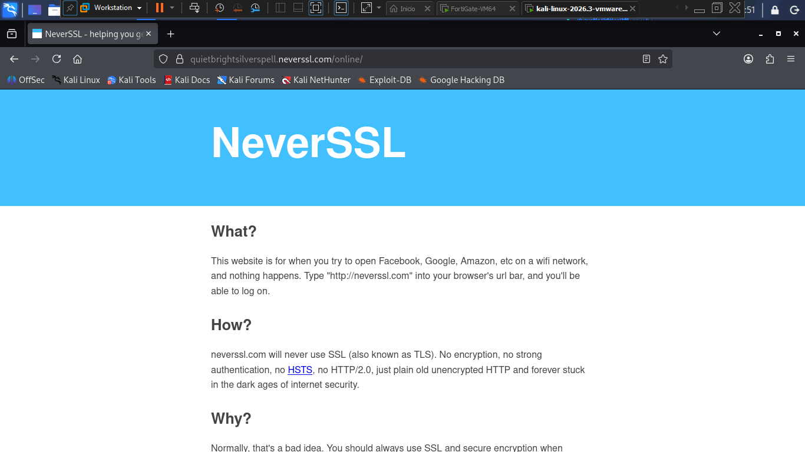

### 4.3 Validación de Restricciones Aplicadas a `Grupo_Invitados`
Con la sesión de `usuario_invitado` activa, el firewall bloquea ICMP (`ping 8.8.8.8`), la ruta HTTPS `https://es.wikipedia.org/wiki/Linux` (Web Filter) y `https://web.whatsapp.com` (Application Control):

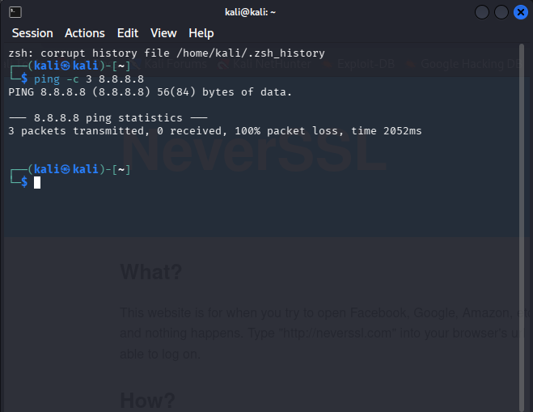
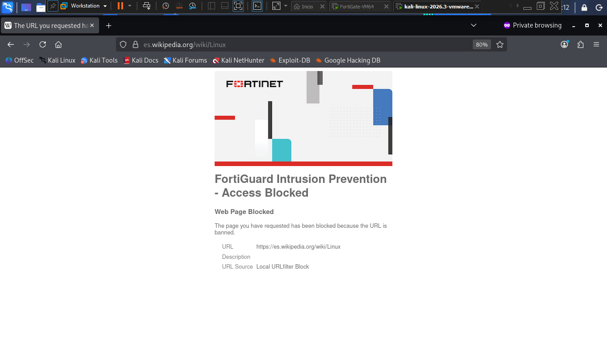
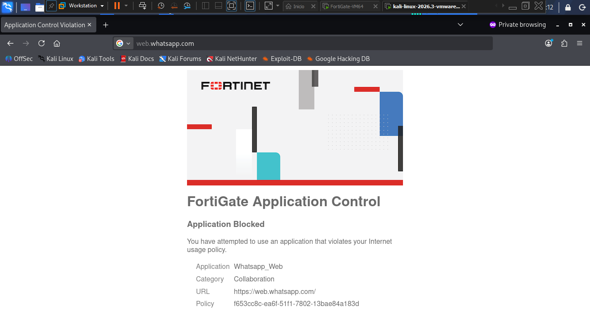

### 4.4 Cambio de Sesión (`diagnose firewall auth clear`) y Privilegios de `usuario_ti`
Tras limpiar la sesión autenticada desde CLI (`diagnose firewall auth clear`), se inició sesión como `usuario_ti` en el Portal Cautivo. Inmediatamente, FortiGate asoció la misma IP `192.168.10.2` a `Politica_Grupo_TI` (ID 3), habilitando ICMP (`0% packet loss`), el artículo `es.wikipedia.org/wiki/GNU/Linux` y `web.whatsapp.com` sin restricciones:


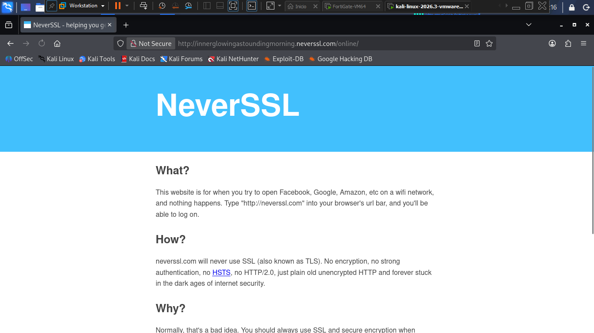
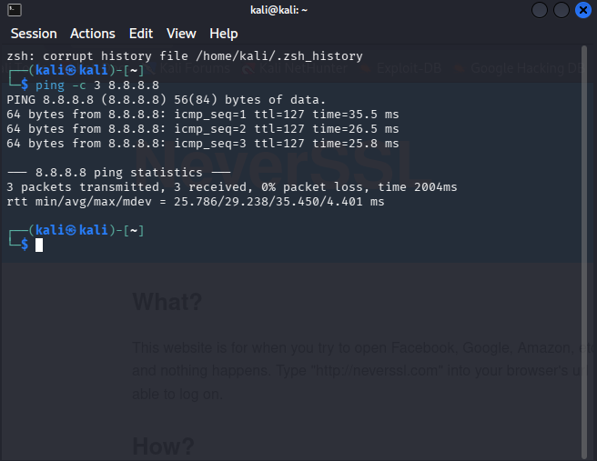
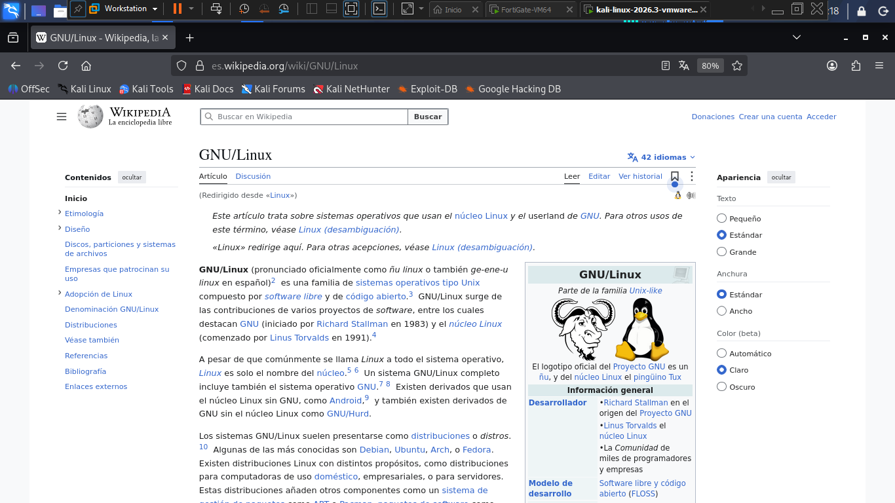
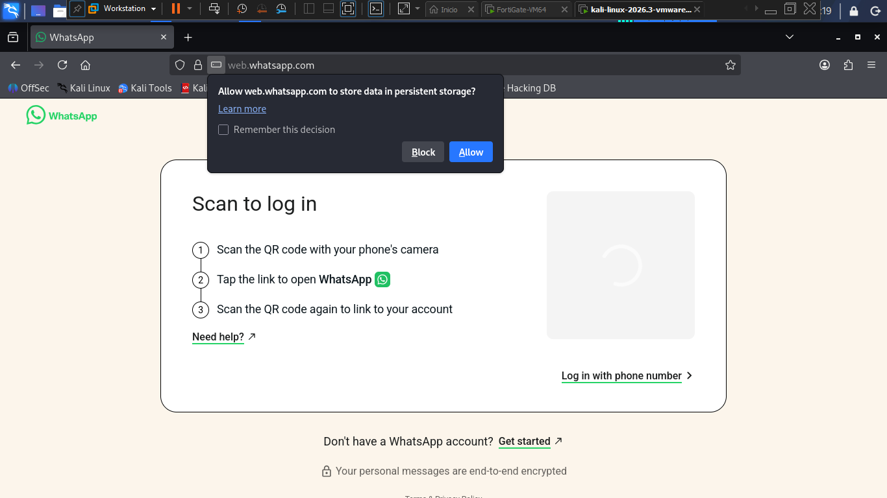

---

## 5. Auditoría de Sesiones Activas y Análisis de Logs

### 5.1 Trazabilidad en Tiempo Real (`FortiView Sessions`)
En **Dashboard > FortiView Sessions**, cada sesión originada desde `192.168.10.2` (`kali`) se etiqueta dinámicamente con la identidad autenticada (`usuario_ti - 192.168.10.2`), demostrando atribución directa a nivel de usuario:

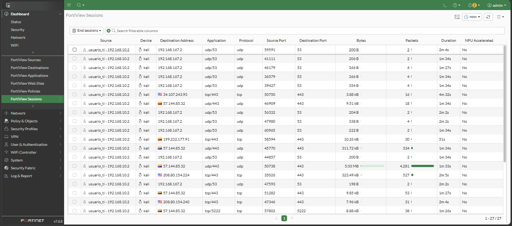
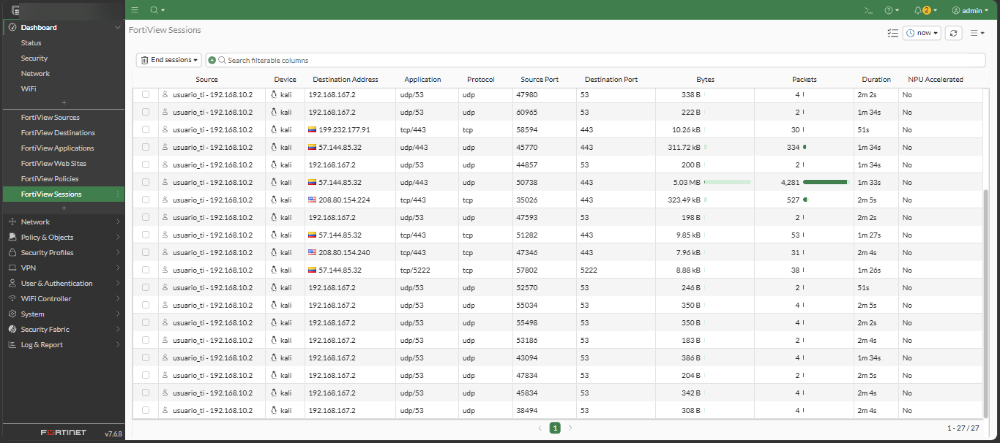

### 5.2 Auditoría Forense de `Forward Traffic` (87 Registros Exportados)
El análisis completo de los **87 eventos** exportados de `Forward Traffic` correspondientes a la sesión de `usuario_invitado` (`06:51:18` – `07:13:30` UTC-8 / `09:51:18` – `10:13:30` hora local Colombia UTC-5) se encuentra documentado en el libro Excel [`reports/FortiGate_CaptivePortal_Analisis_Logs_Lab03.xlsx`](reports/FortiGate_CaptivePortal_Analisis_Logs_Lab03.xlsx) y el registro base en [`reports/disk-traffic-forward-2026-11-27_07-23-sanitized.log`](reports/disk-traffic-forward-2026-11-27_07-23-sanitized.log).

| Métrica / Hallazgo | Valor | Detalle Técnico |
| :--- | :---: | :--- |
| **Total de registros analizados** | **87** | 100% atribuidos a `user="usuario_invitado"`, `group="Grupo_Invitados"` y `policyid=4` (`Politica_Grupo_Invitados`). |
| **Sesiones bloqueadas por UTM (`utmaction="block"`)** | **10 (11.5%)** | 7 bloqueos de `Whatsapp_Web` (`57.144.85.32:443`, 4 con `appact="drop-session"`), 2 bloqueos Web Filter hacia `104.18.4.159:443` (`www.kali.org`) y 1 bloqueo Web Filter hacia `208.80.154.224:443` (`es.wikipedia.org/wiki/Linux`). |
| **Sesiones permitidas (`allow` + intermedios)** | **77 (88.5%)** | 59 cierres permitidos + 18 logs intermedios (`logid="0000000020"`), incluyendo autenticación inicial HTTP en `neverssl.com` (`34.223.124.45:80`) y navegación estándar. |

---

## 6. Matriz de Troubleshooting (Incidencias Resueltas)

| Síntoma / Error | Causa Raíz | Solución Aplicada |
| :--- | :--- | :--- |
| `es.wikipedia.org/wiki/Linux` cargaba (redirigiendo a `/wiki/GNU/Linux`) estando autenticado como `usuario_invitado` | `Politica_Grupo_Invitados` tenía inicialmente `certificate-inspection`, que solo lee el dominio raíz en el SNI (`es.wikipedia.org`) sin descifrar la ruta `/wiki/Linux`. | Se habilitó `custom-deep-inspection` con la CA propia `FortiDPI_2048` en la política de invitados para inspeccionar y bloquear la ruta interna HTTPS. |
| `www.kali.org` seguía cargando pese a tener habilitada la regla comodín `*kali*` en `Web Filter` | Firefox negociaba HTTP/3 sobre **QUIC (`UDP/443`)**. El servicio `HTTPS` en FortiOS incluye `UDP/443`, el cual evade la inspección TLS tradicional (`TCP/443`), sumado al caché local del navegador. | Se agregó un override de bloqueo para la aplicación **QUIC** (`AppID 39224`) en `AppCtrl_Laboratorio`, se ejecutó `diagnose sys session clear` en CLI y se validó en **Ventana Privada** de Firefox. |
| En el export de `Forward Traffic` figuraban únicamente registros de `usuario_invitado` y no de `usuario_ti` | `Politica_Grupo_TI` (ID 3) no tiene perfiles UTM y su opción *Log allowed traffic* permanecía en `Security events`, por lo que FortiOS no registraba sus sesiones permitidas. | Se identificó el comportamiento en auditoría y se documentó el ajuste `set logtraffic all` en `Politica_Grupo_TI` para registrar trazabilidad completa de ambos grupos. |
| Diferencia de 3 horas entre marcas de tiempo de los logs y las capturas en Kali Linux | El reloj del sistema de FortiGate registra eventos en `tz="-0800"` frente a la hora local de Colombia (`UTC-5`). | Se incorporó una columna normalizada a hora local (`UTC-5`) en el libro de análisis Excel para correlacionar exactamente cada prueba con su `sessionid`. |
