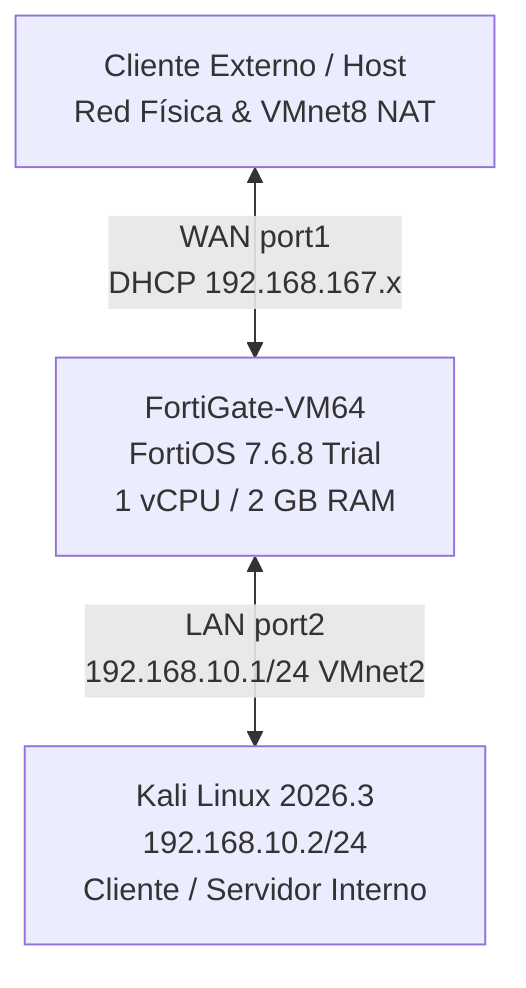

# Fortinet Network Security & Hardening Labs

Portafolio técnico de laboratorios prácticos sobre seguridad perimetral, arquitectura de redes, inspección criptográfica, control de aplicaciones, autenticación por portal cautivo y control de tráfico implementados sobre **FortiGate (FortiOS 7.6.8)** y **Kali Linux 2026.3**.

Cada práctica está documentada como un **Procedimiento Operativo Estándar (SOP)** siguiendo lineamientos de **ISO/IEC 27002:2022**, **ISO/IEC/IEEE 26514** y **NIST SP 800-41 Rev. 1**, incluyendo topologías, bloques CLI sanitizados, pruebas positivas/negativas, auditoría de logs y matrices de resolución de incidencias (*troubleshooting*).

---

## Arquitectura Base del Laboratorio

---

## Índice de Laboratorios

| # | Laboratorio | Tecnologías y Protocolos | Controles ISO/IEC 27002:2022 | Estado |
| :--- | :--- | :--- | :--- | :--- |
| **01** | [**Inspección Profunda SSL/TLS (DPI) con PKI Propia**](01-ssl-tls-deep-inspection-dpi/) | Full SSL Inspection, OpenSSL (RSA 2048), PKCS#1, Firefox NSS, Static URL Filter | **A.8.24** (Criptografía), **A.8.23** (Filtrado web), **A.8.15** (Logs) | Completado |
| **02** | [**Control de Aplicaciones con Firmas Base (Application Control L7)**](02-application-control-base-signatures/) | Application Control (v6.00741), Overrides L7, Evasión SSH-443, WhatsApp/Web, P2P BitTorrent (`aria2c`), Auditoría de Logs (Excel) | **A.8.20** (Seguridad de redes), **A.8.23** (Control apps), **A.8.15** (Logs) | Completado |
| **03** | [**Autenticación, Usuarios Locales, Portal Cautivo y Políticas por Identidad**](03-authentication-captive-portal/) | Captive Portal Local (`port2`), Local Users & Groups (`Grupo_TI` / `Grupo_Invitados`), Identity-Based Policies, Mitigación QUIC, Auditoría Forward Traffic (Excel) | **A.5.15** (Control de acceso), **A.8.5** (Autenticación segura), **A.8.23** (Filtrado web), **A.8.15** (Logs) | Completado |
| **04** | **Publicación Segura de Servicios con Virtual IPs (DNAT)** | Destination NAT (VIP), Port Forwarding en cascada (VMware + FortiOS), HTTP Server | **A.8.20** (Seguridad de redes), **A.8.22** (Segregación) | En documentación |
| **05** | **Control de Ancho de Banda y QoS (Traffic Shaping)** | Shared & Reverse Traffic Shapers, Shaping Policies, Benchmarking con `wget` | **A.8.6** (Gestión de capacidad), **A.8.20** (Seguridad de redes) | En documentación |
| **06** | **Filtrado Estricto L3/L4, DNS Sinkholing y SafeSearch** | Stateful Firewall, Implicit Deny, DNS Filter, SafeSearch / YouTube Restricted Mode | **A.8.22** (Segregación), **A.8.23** (Filtrado web) | En documentación |

---

## Estándares y Prácticas Aplicadas

* **Seguridad Operativa (OpSec):** Todas las configuraciones CLI, registros y capturas publicadas están sanitizadas (`.gitignore` bloquea claves privadas `.key`, `.p12`, `.pem`, las contraseñas figuran redactadas y las capturas de FortiGate omiten/difuminan el número de serie del dispositivo).
* **Enfoque Orientado a Diagnóstico:** Cada laboratorio documenta tanto las pruebas de éxito como las incidencias reales encontradas durante el despliegue, las limitaciones del entorno Trial sin FortiGuard y su resolución técnica.
